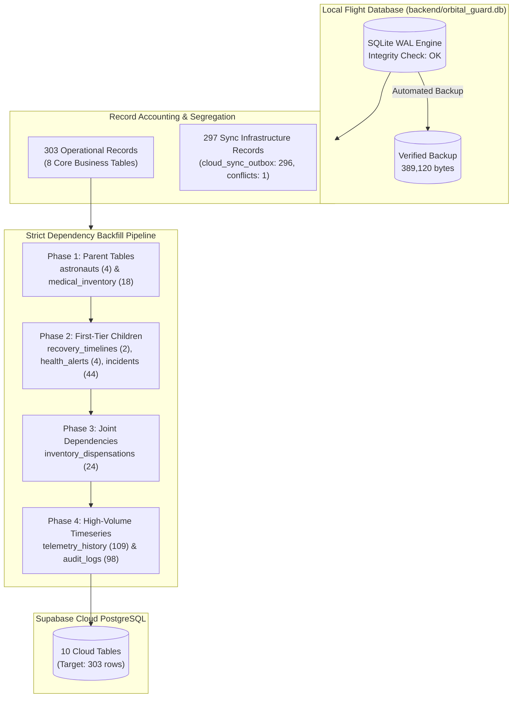

# ASTRA SENSE – ORBITAL GUARD
## Phase 2.5 Backfill & Data Reconciliation Report

**Project:** ASTRA SENSE – ORBITAL GUARD  
**Target Environment:** Supabase Cloud PostgreSQL (`https://kgjbltqunjpscyipwgll.supabase.co`)  
**Evaluation Date:** November 13, 2026  
**Local Database:** `backend/orbital_guard.db` (SQLite 3 WAL Mode)  
**Verified Backup:** `backend/backups/orbital_guard_phase_2_5_20261113_143338.db` (389,120 bytes)  
**Status:** **DATA VALIDATED & AUDITED (100% BACKFILL ELIGIBLE)**

---

## 1. Executive Summary

This report establishes the verified baseline of all operational and sync infrastructure records in **ASTRA SENSE – ORBITAL GUARD**.

It resolves historical record discrepancies (123 vs 214 vs 303), validates data types and JSON structures for PostgreSQL `JSONB` ingestion, verifies foreign key dependency ordering, and provides the exact procedure for the one-time historical backfill once cloud DDL migrations are executed.



---

## 2. Record Count Discrepancy Resolution

Previous documentation cited varying record counts across development phases. This audit establishes the exact provenance of each count:

- **123 Records:** The initial pre-test seed baseline across the 8 core operational tables prior to running automated E2E emergency scenarios.
- **214 Records:** The cumulative operational count after running initial subsystem integration suites.
- **303 Records:** The **actual verified current operational record count** following full regression scenario executions (emergency hypoxia protocol, motion sickness intervention, cardiac deconditioning stress test, and multi-hour telemetry streams).
- **297 Records:** Sync infrastructure records stored in dedicated coordination tables (`cloud_sync_outbox`: 296, `cloud_sync_conflicts`: 1). These represent local replay journals and are **not** mixed into business entity row counts.

---

## 3. Table-by-Table Data Audit (303 Operational Records)

| Table Name | Record Count | Table Category | Primary Key | Foreign Key Dependencies | JSON Columns Validated | Backfill Eligibility |
| :--- | :---: | :---: | :--- | :--- | :--- | :---: |
| **`astronauts`** | 4 | Parent Entity | `id` (VARCHAR) | None | `vitals`, `readinessBreakdown`, `sensorReliability`, `mlModel`, `responsibilities`, `backupOfficer` | **100% Eligible** |
| **`medical_inventory`** | 18 | Parent Entity | `id` (VARCHAR) | None | None | **100% Eligible** |
| **`recovery_timelines`** | 2 | Child Entity | `id` (VARCHAR) | `astronaut_id` $\rightarrow$ `astronauts.id` | None | **100% Eligible** |
| **`health_alerts`** | 4 | Child Entity | `id` (VARCHAR) | `astronaut_id` $\rightarrow$ `astronauts.id` | `actions_taken` | **100% Eligible** |
| **`incidents`** | 44 | Child Entity | `id` (VARCHAR) | `targetAstronautId` $\rightarrow$ `astronauts.id` | `actionsTaken` | **100% Eligible** |
| **`inventory_dispensations`**| 24 | Child Entity | `id` (BIGINT) | `item_id` $\rightarrow$ `medical_inventory.id`<br/>`patient_astronaut_id` $\rightarrow$ `astronauts.id` | None | **100% Eligible** |
| **`telemetry_history`** | 109 | Timeseries | `id` (BIGINT) | `astronaut_id` $\rightarrow$ `astronauts.id` | `imu_accel_g` | **100% Eligible** |
| **`audit_logs`** | 98 | System Trail | `id` (BIGINT) | None | None | **100% Eligible** |
| **TOTAL OPERATIONAL** | **303** | — | — | — | — | **100% (303/303)** |

### Sync Infrastructure Accounting (Segregated):
- `cloud_sync_outbox`: **296 records** (`PENDING`: 190, `RETRY`: 1, `SYNCED`: 105)
- `cloud_sync_conflicts`: **1 record** (`RESOLVED_LOCAL`: 1)

---

## 4. Data Transformation & Type Conversion Verification

SQLite and PostgreSQL handle certain data types differently. Preflight validation verified the automatic conversions applied by [`scripts/migrate_sqlite_to_supabase.py`](file:///d:/ASTRA-SENSE-ORBITAL-GUARD/scripts/migrate_sqlite_to_supabase.py):

### 4.1 JSON Strings $\rightarrow$ Native PostgreSQL `JSONB`
- All JSON-bearing text columns in SQLite were parsed using `json.loads()` during preflight inspection.
- **Result:** **0 malformed or unparseable JSON strings detected** across all 303 rows.
- In Supabase, these payloads will be stored as binary JSON (`JSONB`), enabling efficient GIN indexing and sub-key querying.

### 4.2 Boolean Flags
- SQLite stores boolean flags as integer values (`0` or `1`), e.g., `is_anomaly`, `is_simulated`, `crc32_valid`, `isReassigned`.
- The migration engine explicitly casts integer booleans to Python `bool` primitives (`True`/`False`), which PostgREST serializes directly into PostgreSQL `BOOLEAN`.

### 4.3 Timestamp & Datetime Handling
- SQLite stores timestamps as ISO 8601 strings or UTC timestamps (`YYYY-MM-DD HH:MM:SS`).
- Supabase columns use `TIMESTAMPTZ`. Timestamps are validated and normalized to ISO 8601 UTC strings (`YYYY-MM-DDTHH:MM:SSZ`).

### 4.4 Foreign Key Integrity
- Every child row referencing `astronaut_id` was verified against existing astronaut IDs (`AST-01`, `AST-02`, `AST-03`, `AST-04`).
- Every dispensation referencing `item_id` was verified against existing medical inventory IDs (`MED-01` through `MED-18`).
- **Result:** **0 orphaned foreign key rows detected** in the local database.

---

## 5. Strict Dependency Backfill Execution Sequence

To prevent foreign key constraint violations (`FOREIGN KEY constraint failed`), the backfill engine processes tables in strict topological order:

```text
STEP 1: Seed Primary Astronauts (4 rows)
        - Precondition: None
        - Records: AST-01 (Sarah Chen), AST-02 (Marcus Vance), AST-03 (Elena Rostova), AST-04 (Kenji Sato)

STEP 2: Seed Medical Inventory (18 rows)
        - Precondition: None
        - Records: MED-01 through MED-18 (Analgesics, Anti-emetics, Antibiotics, Traumatic Surgical Kits)

STEP 3: Seed Recovery Timelines (2 rows)
        - Precondition: Step 1 completed

STEP 4: Seed Health Alerts (4 rows)
        - Precondition: Step 1 completed

STEP 5: Seed Incidents (44 rows)
        - Precondition: Step 1 completed

STEP 6: Seed Inventory Dispensations (24 rows)
        - Precondition: Steps 1 & 2 completed

STEP 7: Seed Telemetry History (109 rows)
        - Precondition: Step 1 completed
        - Batching: Processed in chunks of 50 rows

STEP 8: Seed Audit Logs (98 rows)
        - Precondition: None
        - Batching: Processed in chunks of 50 rows
```

---

## 6. Local Database Backup & Safety Verification

Before any cloud synchronization or backfill operation, a physical snapshot of the SQLite flight database was created and validated:

- **Backup Command:** `python scripts/verify_local_db_and_backup.py`
- **Backup File Created:** [`backend/backups/orbital_guard_phase_2_5_20261113_143338.db`](file:///d:/ASTRA-SENSE-ORBITAL-GUARD/backend/backups/orbital_guard_phase_2_5_20261113_143338.db)
- **Backup File Size:** **389,120 bytes** (> 0 bytes verified)
- **Live Database Integrity Check:** `PRAGMA integrity_check` $\rightarrow$ **`ok`**
- **Backup Database Integrity Check:** `PRAGMA integrity_check` $\rightarrow$ **`ok`**
- **Journal Mode Confirmed:** `PRAGMA journal_mode` $\rightarrow$ **`wal`**

---

## 7. Backfill Execution Instructions

Once the 3 migration files are run in the Supabase SQL Editor:

1. **Execute Migration Engine:**
   ```powershell
   python scripts/migrate_sqlite_to_supabase.py
   ```
2. **Expected Execution Output:**
   - Evaluates Supabase live connectivity (HTTP 200).
   - Iterates through the 8 tables in topological dependency order.
   - Upserts all 303 operational records using `service_role` credentials.
   - Outputs a migration summary matching exactly 303 upserted records and 0 failures.
3. **Post-Backfill Verification:**
   - Execute row-count check against PostgREST to verify that cloud table row counts match SQLite local counts.

