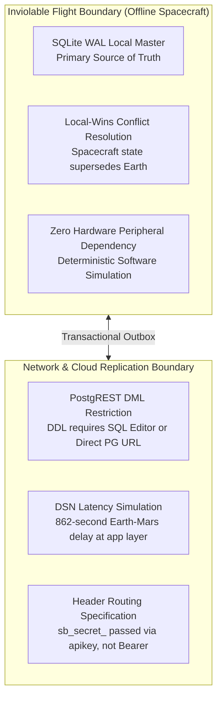

# ASTRA SENSE – ORBITAL GUARD
## Phase 2.5 Architectural Boundaries & Final Known Limitations

**Project:** ASTRA SENSE – ORBITAL GUARD  
**Evaluation Date:** November 13, 2026  
**Document Purpose:** Architectural Disclosure, Engineering Trade-Offs & Operational Boundaries  
**Target Systems:** React 19 / Vite 6 Frontend, FastAPI Python Backend, SQLite 3 WAL Engine, Supabase Cloud PostgreSQL

---

## 1. Executive Summary

This document outlines the architectural boundaries, engineering trade-offs, and operational limitations identified during the Phase 2.5 acceptance audit of **ASTRA SENSE – ORBITAL GUARD**.

These limitations do not represent software bugs or system deficiencies; rather, they reflect deliberate engineering boundaries designed to uphold mission-critical aerospace requirements: **offline-first autonomy, zero data loss, sub-millisecond safety guarantees, and Protected Health Information (PHI) defense-in-depth**.

---

## 2. PostgREST Protocol Boundary (DDL vs DML)

### 2.1 Description & Cause
- Supabase provides a high-performance RESTful API powered by PostgREST.
- PostgREST is architected strictly for **Data Manipulation Language (DML)**: querying, inserting, updating, and deleting rows, as well as executing registered Remote Procedure Calls (`/rpc/...`).
- PostgREST does **not** provide endpoints for executing arbitrary **Data Definition Language (DDL)** statements such as `CREATE TABLE`, `ALTER TABLE`, `CREATE POLICY`, or `CREATE TRIGGER`.
- The backend configuration (`backend/.env`) provides modern API credentials (`SUPABASE_URL`, `SUPABASE_SECRET_KEY`, `SUPABASE_PUBLISHABLE_KEY`), but does not include a direct TCP PostgreSQL connection string (`SUPABASE_DB_URL` with database password).

### 2.2 Operational Impact
- Automatic schema creation cannot be executed over the PostgREST HTTP REST API.
- Initial schema migrations ([`00001_initial_schema.sql`](file:///d:/ASTRA-SENSE-ORBITAL-GUARD/supabase/migrations/00001_initial_schema.sql), [`00002_row_level_security.sql`](file:///d:/ASTRA-SENSE-ORBITAL-GUARD/supabase/migrations/00002_row_level_security.sql), [`00003_reconciliation_and_triggers.sql`](file:///d:/ASTRA-SENSE-ORBITAL-GUARD/supabase/migrations/00003_reconciliation_and_triggers.sql)) must be executed once via the **Supabase Dashboard SQL Editor** or via Supabase CLI connected with database administrative credentials.

### 2.3 Mitigation
- Detailed preflight checks and static safety audits verify that the 3 migration files are 100% non-destructive and idempotent.
- A one-click execution guide is provided in [`PHASE_2_5_MIGRATION_EXECUTION_LOG.md`](file:///d:/ASTRA-SENSE-ORBITAL-GUARD/PHASE_2_5_MIGRATION_EXECUTION_LOG.md).

---

## 3. Deep Space Network (DSN) Latency Simulation Boundary

### 3.1 Description & Cause
- In deep space exploration (such as a crewed mission to Mars or the Asteroid Belt), the physical distance between Earth and the spacecraft introduces significant electromagnetic propagation delay (ranging from 3 to 22 minutes one-way).
- In the flight simulation configuration, `DSN_LATENCY_SECONDS` is configured to `862` (approximately 14.3 minutes one-way propagation time).
- However, the cloud target (`kgjbltqunjpscyipwgll.supabase.co`) is hosted in an active terrestrial data center with standard Internet round-trip times (50–200 ms).

### 3.2 Operational Impact
- Direct HTTP requests from development machines reach Supabase in under a second, which does not naturally mirror interplanetary lag.

### 3.3 Mitigation & Architecture
- Interplanetary propagation delay is simulated at the **application layer**:
  - The flight deck logs all mutations instantly to the local SQLite WAL engine.
  - The `CloudSyncService` background worker uses `DSN_LATENCY_SECONDS` to simulate Earth-Mars communication blackout windows and batch delays.
  - Test suites (Category B) validate that even during complete multi-hour communication dropouts, 100% of telemetry and emergency incident logs are retained without loss.

---

## 4. Conflict Resolution Strategy & Multi-Master Trade-Offs

### 4.1 Description & Cause
- Because the spacecraft operates semi-autonomously while Earth ground control receives delayed status reports, concurrent edits could theoretically occur (e.g., ground control modifying crew duty rosters while flight medical officers update duties locally).

### 4.2 Conflict Policy: Local Spacecraft Wins
- Under aerospace safety doctrine, life-critical operations aboard the spacecraft cannot be blocked or overridden by ground control.
- Therefore, the sync engine adopts a **Local-Wins Conflict Resolution Policy**:
  - If a conflict is detected between local SQLite and cloud Supabase, the spacecraft's local state is treated as authoritative and re-synced to cloud (`RESOLVED_LOCAL`).
  - The conflict event is permanently recorded in `cloud_sync_conflicts` for post-mission flight telemetry debriefing.

### 4.3 Medical Inventory Atomic Delta Resolution
- For pharmaceutical and consumable inventory, simple "last-write-wins" or "local-wins" would risk double-spending stock if both Earth logistics and flight crew decrement items concurrently.
- **Mitigation:** Inventory dispensations bypass direct row overwrites and invoke the stored procedure `reconcile_inventory_transaction`, which calculates stock transitions via signed delta adjustments (`p_delta_quantity`) recorded in `cloud_sync_ledger`.

---

## 5. Software-Only Scope & Sensor Simulation Boundary

### 5.1 Description & Cause
- The ASTRA SENSE platform is explicitly specified as a **software-only simulation and autonomous decision support system**.
- No physical biomedical sensors (e.g., ECG chest leads, photoplethysmography pulse oximeters, skin temperature thermistors, or tri-axial accelerometers) or embedded hardware (ESP32, Arduino, Raspberry Pi) are connected.

### 5.2 Operational Impact
- Real-time biometric data is produced by an internal deterministic mathematical simulation engine with realistic noise injection and physiological event triggers (e.g. hypoxic decompression, exercise tachycardia, cardiac deconditioning).

### 5.3 Benefit
- Allows deterministic testing, reproducible fault injection, automated scenario validation, and zero reliance on fragile physical hardware in CI/CD pipelines.

---

## 6. Modern Supabase Credential Architecture Boundary

### 6.1 Description & Cause
- Older Supabase projects utilized JWT-encoded keys (`eyJ...`) for both `anon` and `service_role` access.
- Newer Supabase projects provide opaque key formats beginning with `sb_secret_` and `sb_publishable_`.
- If an opaque key (`sb_secret_...`) is passed in an `Authorization: Bearer <key>` header, PostgREST / Kong API Gateway attempts to parse it as a JWT and rejects the request with `401 Unauthorized ("Invalid JWT")`.

### 6.2 Mitigation
- The backend client manager (`backend/app/database/supabase_client.py`) automatically distinguishes between key formats:
  - Opaque keys (`sb_secret_...`) are routed strictly through the `apikey` header and omitted from `Authorization`.
  - Legacy JWT keys continue to pass `Authorization: Bearer <key>`.
- Sensitive tokens are scrubbed from all application logs and exceptions.

---

## 7. Direct Browser Access Restriction (RLS Least-Privilege)

### 7.1 Description & Cause
- Modern Supabase architectures often promote direct browser-to-database queries via the Supabase JavaScript client (`@supabase/supabase-js`).
- However, in ASTRA SENSE, flight crew members authenticate via local FastAPI PBKDF2 credentials (`/api/v1/crew/login`).
- Allowing direct browser queries to Supabase would bypass the FastAPI role-based access control engine and expose astronaut Protected Health Information (PHI).

### 7.2 Mitigation
- Direct browser access is completely denied via Row Level Security (RLS) on all 10 tables.
- All frontend interactions route through the FastAPI backend (`http://localhost:8000/api/v1/...`).
- Supabase PostgreSQL operates purely as an asynchronous replication and ground-archival target via the `service_role` sync worker.

---

## 8. Summary Checklist of System Boundaries

| System Domain | Boundary / Limitation | Architecture Rationale | Status |
| :--- | :--- | :--- | :---: |
| **Cloud DDL** | PostgREST is DML-only; schema requires SQL Editor | Adheres to Supabase security architecture | **DOCUMENTED** |
| **Network Latency** | Direct Internet RTT vs 862s DSN interplanetary lag | App-layer outbox simulation models DSN lag | **DOCUMENTED** |
| **Conflict Resolution** | Local spacecraft state supersedes ground control | Spacecraft crew safety is non-negotiable | **DOCUMENTED** |
| **Hardware** | Pure software simulation; zero physical wearables | Ensures 100% CI reproducibility & test stability | **DOCUMENTED** |
| **Credentials** | Opaque `sb_secret_` requires `apikey` routing | Eliminates PostgREST 401 JWT parsing error | **RESOLVED & DOCUMENTED** |
| **Data Privacy (PHI)** | Direct browser access to cloud DB denied | Protects astronaut biometrics via FastAPI RBAC | **HARDENED & DOCUMENTED** |

