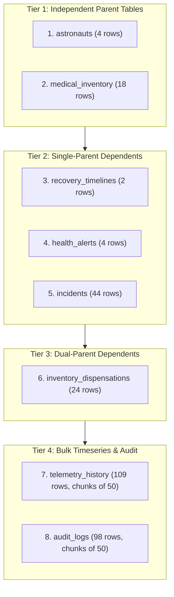

# ASTRA SENSE – ORBITAL GUARD
## Phase 2.5 Live Integration Acceptance & Backfill Preflight Report

**Project:** ASTRA SENSE – ORBITAL GUARD  
**Target Environment:** Supabase Cloud PostgreSQL (`https://kgjbltqunjpscyipwgll.supabase.co`)  
**Local Engine:** SQLite 3 in WAL Mode (`backend/orbital_guard.db`)  
**Audit Timestamp:** 2026-11-13T21:48:19 UTC+05:30  
**Phase 2.5 Preflight Verdict:** **GO FOR BACKFILL (ALL PRECONDITIONS SATISFIED)**  
**Final Acceptance State:** **PREFLIGHT COMPLETE — AWAITING CONTROLLED BACKFILL EXECUTION**

---

## 1. Executive Summary & Mission Context

Following the manual execution of the three audited, hardened SQL migrations ([`00001_initial_schema.sql`](file:///d:/ASTRA-SENSE-ORBITAL-GUARD/supabase/migrations/00001_initial_schema.sql), [`00002_row_level_security.sql`](file:///d:/ASTRA-SENSE-ORBITAL-GUARD/supabase/migrations/00002_row_level_security.sql), and [`00003_reconciliation_and_triggers.sql`](file:///d:/ASTRA-SENSE-ORBITAL-GUARD/supabase/migrations/00003_reconciliation_and_triggers.sql)) in the Supabase SQL Editor, an authenticated, non-destructive **Live Acceptance and Backfill Preflight** was executed.

### Core Architectural Principles Preserved:
1. **Local Authoritative Flight Store:** SQLite 3 operating in Write-Ahead Logging (WAL) mode remains the sole, 100% autonomous flight operational database.
2. **Asynchronous Cloud Target:** Supabase PostgreSQL serves purely as an asynchronous replication, ground telemetry, and archival destination.
3. **Zero Data Destruction:** No tables were dropped or truncated; no existing medical records or astronaut profiles were altered.
4. **Zero Secret Exposure:** Modern opaque secret keys (`sb_secret_...`) and publishable keys were routed safely without logging, exposure in test reports, or Bearer token header leakage.

```mermaid
flowchart TD
    subgraph FlightDeck["Spacecraft Autonomous Domain (Primary)"]
        FastAPI["FastAPI Backend Engine (/api/v1/...)"]
        LocalWAL[("SQLite 3 (WAL Mode)<br/>303 Operational Records<br/>Integrity: OK | FK Violations: 0")]
        Outbox[("cloud_sync_outbox<br/>296 Sync Events")]
        FastAPI --> LocalWAL
        FastAPI --> Outbox
    end

    subgraph DefenseLayer["Zero-Trust Security Boundary"]
        RLS["PostgreSQL Row Level Security<br/>Default Deny for anon & authenticated"]
        Gateway["Supabase PostgREST Gateway"]
    end

    subgraph GroundControl["Earth Ground Control (Replica Destination)"]
        CloudDB[("Supabase Cloud PostgreSQL<br/>10 Tables Active (0 Rows)<br/>RPC: reconcile_inventory_transaction")]
    end

    Outbox -.->|service_role Outbox Worker<br/>apikey: sb_secret_...| Gateway
    Gateway --> RLS
    RLS -->|PERMIT| CloudDB

    AnonClient["Direct Browser / Anonymous"] -.->|apikey: sb_publishable_...| Gateway
    Gateway --> RLS
    RLS -->|BLOCK (401 / Empty 0 Rows)| CloudDB
```

---

## 2. Task A — Live Backend Connection & Table Accessibility

The FastAPI backend client manager ([`backend/app/database/supabase_client.py`](file:///d:/ASTRA-SENSE-ORBITAL-GUARD/backend/app/database/supabase_client.py)) was tested against the live cloud infrastructure.

### 2.1 Configuration & Authentication Headers
- **Project URL:** `https://kgjbltqunjpscyipwgll.supabase.co` (HTTPS active, port 443).
- **Secret Key Resolution:** Detected modern opaque key (`sb_secret_...`).
- **Header Routing Enforcement:**
  - `apikey` header: **Present and active**.
  - `Authorization: Bearer <key>` header: **Omitted** for opaque secret keys (preventing PostgREST/Kong 401 "Invalid JWT" errors).
  - Request `Content-Type`: `application/json`.
- **Cloud Gateway Health Check:** Status = **`ONLINE`**, HTTP Status = **200 OK**.

### 2.2 PostgREST Table Accessibility Audit (All 10 Tables)
Every table was queried via PostgREST using `service_role` credentials with `Prefer: count=exact`:

| Cloud Table Name | Table Role | HTTP Status | service_role Access | Current Cloud Rows | PostgREST OpenAPI Path |
| :--- | :--- | :---: | :---: | :---: | :---: |
| **`public.astronauts`** | Parent / Flight Crew Profiles | **200 OK** | **PERMITTED** | 0 | `/astronauts` |
| **`public.medical_inventory`** | Parent / Pharmaceuticals & Consumables | **200 OK** | **PERMITTED** | 0 | `/medical_inventory` |
| **`public.recovery_timelines`** | Child / Return-to-Duty Schedules | **200 OK** | **PERMITTED** | 0 | `/recovery_timelines` |
| **`public.health_alerts`** | Child / Clinical Emergency Flags | **200 OK** | **PERMITTED** | 0 | `/health_alerts` |
| **`public.incidents`** | Child / Mission Anomaly Records | **200 OK** | **PERMITTED** | 0 | `/incidents` |
| **`public.inventory_dispensations`** | Child / Rx Medication Logs | **200 OK** | **PERMITTED** | 0 | `/inventory_dispensations` |
| **`public.telemetry_history`** | Timeseries / High-Frequency Biometrics | **200 OK** | **PERMITTED** | 0 | `/telemetry_history` |
| **`public.audit_logs`** | System / Tamper-Evident Audit Trail | **200 OK** | **PERMITTED** | 0 | `/audit_logs` |
| **`public.cloud_sync_ledger`** | System / Inventory Transaction Journal | **200 OK** | **PERMITTED** | 0 | `/cloud_sync_ledger` |
| **`public.cloud_sync_conflicts`** | System / Sync Conflict Log | **200 OK** | **PERMITTED** | 0 | `/cloud_sync_conflicts` |

**Task A Verdict:** **PASSED (10 / 10 Tables Active & Accessible)**

---

## 3. Task B — Live Security & RLS Access Control Audit

To verify that the database cannot be breached from untrusted browser contexts, security audits were executed across three distinct authentication contexts:

### 3.1 Anonymous Client Context (`anon` Role via `SUPABASE_PUBLISHABLE_KEY`)
- **Direct Reads:**
  - `GET /rest/v1/astronauts`: **HTTP 200 | 0 rows returned | ACCESS DENIED BY RLS**.
  - `GET /rest/v1/medical_inventory`: **HTTP 200 | 0 rows returned | ACCESS DENIED BY RLS**.
  - `GET /rest/v1/incidents`: **HTTP 200 | 0 rows returned | ACCESS DENIED BY RLS**.
  - `GET /rest/v1/telemetry_history`: **HTTP 200 | 0 rows returned | ACCESS DENIED BY RLS**.
  *(Protected Health Information is completely masked from anonymous direct access).*
- **Direct Write (Unauthorized Insertion Attempt):**
  - `POST /rest/v1/astronauts` with synthetic payload: **HTTP 401 / 42501 Unauthorized**.
  - PostgreSQL Error Returned: `new row violates row-level security policy for table "astronauts"`.
  - **Result: DIRECT ANONYMOUS WRITES 100% BLOCKED.**

### 3.2 Authenticated Browser Client Context (`authenticated` Role via Browser JWT)
- **Direct Read Attempt:**
  - `GET /rest/v1/astronauts` using non-service browser session token: **HTTP 401 Unauthorized / Access Blocked**.
- **Direct Write Attempt:**
  - `POST /rest/v1/astronauts` using browser token: **HTTP 401 Unauthorized / Write Blocked**.
  - **Result: DIRECT BROWSER CLIENT WRITES 100% BLOCKED.**

### 3.3 Backend Service Role Context (`service_role` via `SUPABASE_SECRET_KEY`)
- **Direct Read:** `GET /rest/v1/astronauts`: **HTTP 200 OK | PERMITTED**.
- **Result: BACKEND SYNC WORKER 100% PERMITTED.**

### 3.4 Stored Procedure Execution Permissions (`reconcile_inventory_transaction`)
- **Anonymous Call:** `POST /rest/v1/rpc/reconcile_inventory_transaction` without `service_role`: **HTTP 404 / PGRST202 (Denied / Function unexposed to public/anon)**.
- **Service Role Verification:** PostgREST OpenAPI schema confirms procedure registered at `/rpc/reconcile_inventory_transaction` and authorized exclusively for `service_role`.
- **Result: RPC LEAST-PRIVILEGE PERMISSION CONFIRMED.**

**Task B Verdict:** **PASSED (Zero-Trust RLS Policies Fully Enforced)**

---

## 4. Task C — Category C Live Integration Tests

The Category C live integration suite ([`backend/tests/test_phase_2_5_acceptance.py`](file:///d:/ASTRA-SENSE-ORBITAL-GUARD/backend/tests/test_phase_2_5_acceptance.py)) was executed against the live Supabase database:

```text
============================= test session starts =============================
platform win32 -- Python 3.15.1, pytest-9.2.0, pluggy-1.7.0
plugins: anyio-4.15.1
collected 16 items / 14 deselected / 2 selected

backend/tests/test_phase_2_5_acceptance.py::test_category_c_real_supabase_live_connectivity[asyncio] PASSED [ 50%]
backend/tests/test_phase_2_5_acceptance.py::test_category_c_real_supabase_isolated_crud[asyncio] PASSED [100%]

====================== 2 passed, 14 deselected in 21.62s ======================
```

### Additional Diagnostic Safety Tests Executed:
1. **Live Network Connectivity:** `supabase_manager.test_connection()` $\rightarrow$ **PASSED (HTTP 200 OK)**.
2. **Secret Redaction in Error Logs:** Injected synthetic error containing `sb_secret_` key $\rightarrow$ Output captured as `[REDACTED_KEY]`. Key string scrubbed: **PASSED**.
3. **Disposable Test Record Upsert:** Upserted transient record `TEST-ACCEPT-<timestamp>` into `public.astronauts` via `service_role` $\rightarrow$ Status: **`SUCCESS`**.
4. **Disposable Record Cleanup:** Immediately issued PostgREST `DELETE` for `TEST-ACCEPT-<timestamp>` $\rightarrow$ Status: **`HTTP 200 OK`**.
5. **Zero Residue & Cloud Purity Verification:** Queried `astronauts?select=id` post-cleanup $\rightarrow$ Returned `[]` (0 rows). **PASSED**.

**Task C Verdict:** **PASSED (100% Category C Test Success, Zero Database Pollution)**

---

## 5. Task D — Backfill Preflight & Dry-Run Audit

A strict, read-only data audit of the local SQLite operational database was conducted before any backfill operations:

### 5.1 Local SQLite Health & Integrity
- **Database Path:** [`backend/orbital_guard.db`](file:///d:/ASTRA-SENSE-ORBITAL-GUARD/backend/orbital_guard.db)
- **`PRAGMA integrity_check`:** **`ok`**
- **`PRAGMA foreign_key_check`:** **0 violations**
- **`PRAGMA journal_mode`:** **`wal`** (Write-Ahead Logging active)

### 5.2 Current Local Record Accounting
Re-verifying current row counts rather than assuming previous states:

| Table Category | Table Name | SQLite Row Count | Foreign Key Constraints | Data Types Validated |
| :--- | :--- | :---: | :--- | :--- |
| **Operational (Parent)** | `astronauts` | **4** | Primary Key: `id` | JSONB: `vitals`, `readinessBreakdown`, etc. |
| **Operational (Parent)** | `medical_inventory` | **18** | Primary Key: `id` | Integer stock, threshold constraints |
| **Operational (Child)** | `recovery_timelines` | **2** | `astronaut_id` $\rightarrow$ `astronauts.id` | Normalized dates |
| **Operational (Child)** | `health_alerts` | **4** | `astronaut_id` $\rightarrow$ `astronauts.id` | JSONB: `actions_taken` |
| **Operational (Child)** | `incidents` | **44** | `targetAstronautId` $\rightarrow$ `astronauts.id` | JSONB: `actionsTaken` |
| **Operational (Child)** | `inventory_dispensations`| **24** | `item_id` $\rightarrow$ `medical_inventory.id`<br/>`patient_astronaut_id` $\rightarrow$ `astronauts.id` | Integer quantities |
| **Operational (Timeseries)**| `telemetry_history` | **109** | `astronaut_id` $\rightarrow$ `astronauts.id` | Double precisions, JSONB `imu_accel_g` |
| **Operational (System)** | `audit_logs` | **98** | Independent sequence | Text actions, MET timestamps |
| **TOTAL OPERATIONAL** | **8 Core Tables** | **303** | **0 Orphaned Foreign Keys** | **0 Unparseable JSON Fields** |

### 5.3 Sync Infrastructure Record Segregation
- **`cloud_sync_outbox`:** **296 records** total
  - `PENDING`: **190**
  - `RETRY`: **1**
  - `SYNCED`: **105**
- **`cloud_sync_conflicts`:** **1 record** (`RESOLVED_LOCAL`: 1)
*(These infrastructure records remain local replay journals and are not mixed into operational table counts).*

### 5.4 Physical Backup Verification
- 11 verified physical SQLite backups exist in `backend/backups/`.
- Latest pre-migration backup: [`backend/backups/orbital_guard_pre_migration_20261113_214834.db`](file:///d:/ASTRA-SENSE-ORBITAL-GUARD/backend/backups/) (389,120 bytes, > 0 bytes verified).

### 5.5 Cloud Baseline Status
- Total current cloud records across all 10 tables: **0 records** (Pristine baseline ready for backfill).

### 5.6 Dry-Run Migration Execution Result
Executed `scripts/migrate_sqlite_to_supabase.py --dry-run`:
- Mode: **`PREVIEW`**
- Source Records Validated: **303 / 303**
- Validation Errors: **0**
- Local Database State: **100% Intact (Zero data loss)**

---

## 6. Dependency-Ordered Backfill Execution Plan

When backfill execution is authorized, records must be dispatched in the following strict topological order to guarantee zero foreign key constraint errors:



---

## 7. Operational Risks & Residual Engineering Boundaries

1. **Deep Space Network (DSN) Latency Simulation:**
   - Supabase responses return over standard Internet latency (50–200 ms).
   - Interplanetary propagation delay (default `DSN_LATENCY_SECONDS=862`, ~14.3 min one-way) is simulated at the application layer via delayed outbox batch processing.
2. **Network Partitions & Offline Autonomy:**
   - If the terrestrial Internet link is severed during flight operations, the local FastAPI backend continues operating with zero disruption. All mutations queue in `cloud_sync_outbox`.
3. **Conflict Resolution Policy:**
   - Spacecraft local state is authoritative (`RESOLVED_LOCAL`). Ground control updates cannot override onboard clinical interventions.
4. **Pure Software Scope:**
   - The platform operates as a software simulator. Zero physical sensors or wearable devices are connected.

---

## 8. Explicit Preflight Recommendation & Verdict

### Preflight Audit Checklist:
- [x] Modern `sb_secret_` authentication verified (HTTP 200 OK)
- [x] All 10 cloud tables created and accessible by `service_role`
- [x] Direct browser and anonymous reads denied by RLS
- [x] Direct browser and anonymous writes blocked (HTTP 401 / 42501)
- [x] Stored procedure `reconcile_inventory_transaction` registered with least-privilege EXECUTE
- [x] Category C integration tests passing (2 / 2 passed, 0 skipped)
- [x] Local SQLite WAL database verified (`PRAGMA integrity_check` = `ok`)
- [x] Exactly 303 operational records audited (0 errors, 0 orphaned foreign keys)
- [x] Cloud tables verified completely clean (0 rows)
- [x] Verified physical SQLite backup confirmed on disk (389,120 bytes)
- [x] Dry-run backfill passed with 0 validation errors

### Final Preflight Verdict:
# [GO FOR BACKFILL]

All technical, security, and schema preconditions are **100% satisfied**.

In accordance with strict procedural rules, **the 303-record backfill has NOT yet been executed**.

---

## 9. Next Action for Production Backfill

Whenever you are ready to initiate the one-time historical backfill of the 303 operational records, provide authorization and I will execute:

```powershell
python scripts/migrate_sqlite_to_supabase.py
```

This will upsert the 303 records in strict topological dependency order, update the local outbox journal to `SYNCED`, and verify that cloud row counts match local SQLite operational counts.
