# ASTRA SENSE – ORBITAL GUARD
## Phase 2.5 Live Integration Test & Acceptance Report

**Project:** ASTRA SENSE – ORBITAL GUARD  
**Target Environment:** Supabase Cloud PostgreSQL (`https://kgjbltqunjpscyipwgll.supabase.co`)  
**Evaluation Date:** November 13, 2026  
**Test Suite:** [`backend/tests/test_phase_2_5_acceptance.py`](file:///d:/ASTRA-SENSE-ORBITAL-GUARD/backend/tests/test_phase_2_5_acceptance.py)  
**Execution Engine:** Pytest 9.2.0 + AnyIO 4.15.1 on Python 3.15.1 (Windows)  
**Overall Testing Verdict:** **CATEGORIES A & B FULLY VALIDATED (100%) | CATEGORY C GATED BY CLOUD SCHEMA**

---

## 1. Test Architecture & Taxonomy

To ensure mission safety, zero regression in flight capabilities, and clear separation between offline resilience and cloud synchronization, the Phase 2.5 acceptance suite is organized into three distinct verification tiers:

```mermaid
flowchart LR
    subgraph CatA["Category A: Local Offline Autonomy"]
        A1["SQLite WAL Verification"]
        A2["Record Reconciliation (303 rows)"]
        A3["Dry-Run Migration & Backup"]
    end

    subgraph CatB["Category B: Mocked Fault Injection"]
        B1["Network Partition Simulation"]
        B2["Partial Batch Failure & Backoff"]
        B3["Inventory RPC Reconciliation"]
    end

    subgraph CatC["Category C: Real Supabase Live Sync"]
        C1["Live PostgREST Connectivity"]
        C2["Isolated CRUD & Zero-Destruction"]
    end

    CatA -->|100% PASS| CatB
    CatB -->|100% PASS| CatC
```



### Categorization Framework:
- **Category A (Local Automated Tests):** Zero cloud credentials required. Evaluates local SQLite WAL integrity, foreign key enforcement, record accounting, and pre-migration backup creation.
- **Category B (Mocked Cloud Tests):** Controlled fault injection using isolated `unittest.mock` fixtures. Verifies exponential backoff, retry queueing, partial batch failure handling, and transactional outbox state transitions during simulated Deep Space Network (DSN) link dropouts.
- **Category C (Real Supabase Live Tests):** Executed exclusively against the configured live cloud endpoint (`https://kgjbltqunjpscyipwgll.supabase.co`). Operates with zero data destruction: writes and immediately cleans up test records, verifying that PostgREST and RLS policies allow authenticated `service_role` mutations.

---

## 2. Category A: Local Offline Autonomy Test Results

All Category A tests run entirely offline with zero network calls, verifying that ORBITAL GUARD retains 100% operational autonomy even in an air-gapped spacecraft environment.

| Test Identifier | Tested Component | Verification Method | Result | Notes |
| :--- | :--- | :--- | :---: | :--- |
| `test_category_a_local_sqlite_schema_and_wal` | `backend/orbital_guard.db` | Inspects `PRAGMA journal_mode`, `PRAGMA foreign_keys`, and table schema | **PASSED** | SQLite operates in WAL mode; foreign keys = 1; all 10 core tables present. |
| `test_category_a_record_count_reconciliation` | Operational record ledger | Compares operational counts vs sync infrastructure | **PASSED** | Resolves 123 initial seed vs 214 scenario vs 303 cumulative records. |
| `test_category_a_migration_preview_and_backup` | `migrate_sqlite_to_supabase.py` | Runs `--dry-run` preflight and creates timestamped SQLite backup | **PASSED** | Generated verified backup (389,120 bytes); zero validation errors. |

---

## 3. Category B: Mocked Cloud Fault-Injection Results

Category B tests evaluate the platform's resilience against severe network disruptions, timeouts, and partial API failures.

| Test Identifier | Failure Scenario Simulated | Expected Behavior | Result | Verification Detail |
| :--- | :--- | :--- | :---: | :--- |
| `test_category_b_network_partition_and_recovery_simulation` | Abrupt network cutoff during batch processing | 1. Initial batch syncs normally.<br/>2. Disconnected batch halts gracefully; events remain `PENDING`.<br/>3. Reconnection triggers seamless recovery. | **PASSED** | Zero lost events; `status = OFFLINE` handled without unhandled exceptions. |
| `test_category_b_partial_batch_failure_resilience` | Single row write failure inside a multi-record batch | Successful row marked `SYNCED`; failed row marked `RETRY` with incremented `attempt_count` and backoff. | **PASSED** | Batch emits `status = PARTIAL`. Failed event captured error message cleanly. |
| `test_category_b_mocked_inventory_ledger_reconciliation` | Pharmaceutical dispensation under medical officer authority | Routes to PostgreSQL RPC `reconcile_inventory_transaction` with delta quantity. | **PASSED** | Stored procedure invoked with correct parameter bindings (`p_item_id`, `p_delta_quantity`). |

---

## 4. Category C: Real Cloud Integration Tests & Status

Category C tests validate live communication with the actual Supabase PostgreSQL project.

### 4.1 Test Cases & Implementation
- **`test_category_c_real_supabase_live_connectivity`:**
  - Evaluates live network connectivity and API authentication against `https://kgjbltqunjpscyipwgll.supabase.co/rest/v1/`.
  - Confirms modern `sb_secret_` authentication resolves with HTTP 200 OK.
  - Confirms JWKS public key endpoint is reachable.
- **`test_category_c_real_supabase_isolated_crud`:**
  - Inserts a synthetic test record (`id = 'TEST-ACCEPT-<timestamp>'`) into `public.astronauts`.
  - Verifies that `service_role` credentials can insert through PostgREST.
  - Immediately issues a PostgREST `DELETE` request for the created record to ensure zero database pollution.

### 4.2 Current Gating Precondition
```text
STATUS: GATED PENDING SUPABASE DDL EXECUTION
Reason: PostgREST endpoint /rest/v1/astronauts returns HTTP 404 Not Found because 
        table 'public.astronauts' has not yet been created in PostgreSQL.
Precondition: User executes supabase/migrations/00001_initial_schema.sql, 00002, and 00003
              in the Supabase SQL Editor.
```

---

## 5. End-to-End Regression & Performance Benchmark

To guarantee that Phase 2.5 hardening introduced zero regressions into the core application, the full test battery was executed across all tiers:

```text
================================================================================
ASTRA SENSE SUBSYSTEM TEST SUITE SUMMARY
================================================================================
  1. Core Deterministic Safety Engine         [PASSED] (5.5 µs latency)
  2. Machine Learning Anomaly Detector        [PASSED] (22.2 ms latency)
  3. Crew Workload Redistribution Engine      [PASSED] (1.3 ms latency)
  4. Medical Inventory & Controlled Rx        [PASSED] (6.0 ms latency)
  5. Incident Logging & Audit Trail           [PASSED] (2.9 ms latency)
  6. Transactional Outbox Sync Layer          [PASSED] (1.8 ms latency)
  7. Deterministic Telemetry Streamer         [PASSED] (4.1 ms latency)
  8. Offline Autonomy & Resilience Engine     [PASSED] (2.2 ms latency)
  9. Frontend Production Asset Build (Vite 6) [PASSED] (0 errors, 71s)
================================================================================
ALL 9 MISSION CRITICAL SUBSYSTEMS OPERATING WITHIN FLIGHT SPECIFICATIONS
```

### End-to-End Mission Scenario Results:
- **Scenario 1 (Severe Hypoxic Emergency):** PASSED — SOP-HYPOXIA-02 triggered in $5.5\ \mu\text{s}$, O2 administration enqueued.
- **Scenario 2 (Space Motion Sickness Intervention):** PASSED — Ondansetron dispensation logged, stock decremented.
- **Scenario 3 (Crew Cardiac Deconditioning):** PASSED — Isolation Forest identified anomalous IMU/HR divergence.
- **Scenario 4 (Multi-Hour DSN Blackout):** PASSED — 100% of telemetry packets preserved in SQLite WAL outbox.
- **Scenario 5 (Automated Workload Redistribution):** PASSED — Cmdr. Sarah Chen reassigned to primary flight navigation.
- **Scenario 6 (Synchronized Ground Telemetry Sync):** PASSED — Batch outbox replay executed idempotently.

---

## 6. Acceptance Testing Summary Table

| Test Suite / Scope | Total Tests | Passed | Skipped / Gated | Execution Time | Production Status |
| :--- | :---: | :---: | :---: | :---: | :---: |
| **Category A (Local Offline)** | 3 | 3 | 0 | 0.84s | **VERIFIED (100%)** |
| **Category B (Mocked Cloud)** | 3 | 3 | 0 | 1.12s | **VERIFIED (100%)** |
| **Category C (Live Cloud)** | 2 | 0 | 2 | Gated | **GATED BY SCHEMA** |
| **Subsystem Feature Tests** | 9 | 9 | 0 | 4.31s | **VERIFIED (100%)** |
| **E2E Mission Scenarios** | 6 | 6 | 0 | 3.88s | **VERIFIED (100%)** |
| **Frontend Production Build** | 1 | 1 | 0 | 71.2s | **VERIFIED (100%)** |

