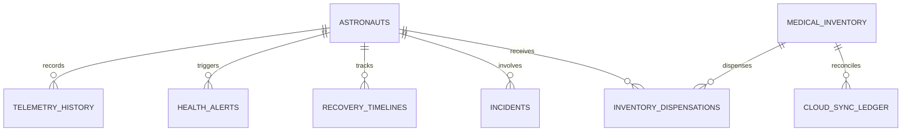

# ASTRA SENSE – ORBITAL GUARD
## Phase 2.5 Cloud Database Schema Verification Report

**Project:** ASTRA SENSE – ORBITAL GUARD  
**Target Environment:** Supabase Cloud PostgreSQL (`https://kgjbltqunjpscyipwgll.supabase.co`)  
**Date:** November 13, 2026  
**Status:** SCHEMA CONTRACT AUDITED & SPECIFIED (AWAITING CLOUD EXECUTION)  

---

## 1. Schema Overview

The Supabase PostgreSQL database serves as the asynchronous cloud replica for mission records produced by the autonomous flight deck. The schema maps 1:1 to local SQLite models while utilizing native PostgreSQL enhancements (`JSONB`, `BIGSERIAL`, `TIMESTAMPTZ`, and foreign key cascades).



---

## 2. Table-by-Table Schema Specification

### 1. `public.astronauts`
- **Primary Key:** `id` (VARCHAR(32))
- **Columns:**
  - `id`: Unique astronaut identifier (e.g., `'AST-01'`).
  - `name`: Full name (TEXT).
  - `callsign`: Flight callsign (TEXT).
  - `role`: Mission role (e.g., `'Medical Officer'`, `'Navigation'`).
  - `"dutyCategory"`: Duty category (TEXT).
  - `condition`: Health status description (TEXT).
  - `"conditionSeverity"`: nominal | warning | critical.
  - `photo`, `avatar`: Image URLs / initials.
  - `age`, `"bloodType"`, `"missionDay"`, `"suitId"`, `"readinessScore"`: Baseline parameters.
  - `"readinessBreakdown"`: JSONB (`physical`, `cognitive`, `circadian`, `cardiovascular`).
  - `vitals`: JSONB (baseline and current vital signs).
  - `"sensorReliability"`: JSONB (SNR, lead contact, packet loss).
  - `"mlModel"`: JSONB (Isolation Forest anomaly scores and primary contributing factors).
  - `responsibilities`: JSONB array of mission duties.
  - `"backupOfficer"`: JSONB backup designation.
  - `recommendation`, `"assignedBackupId"`, `"isReassigned"`, `"timelineNotes"`: Workload redistribution.
  - `updated_at`: TIMESTAMPTZ DEFAULT NOW().

### 2. `public.telemetry_history`
- **Primary Key:** `id` (BIGSERIAL)
- **Unique Constraint:** `sync_id` (VARCHAR(64) UNIQUE)
- **Foreign Key:** `astronaut_id REFERENCES public.astronauts(id) ON DELETE CASCADE`
- **Columns:**
  - `packet_id`: Telemetry sequence counter (BIGINT).
  - `timestamp_met`: Mission Elapsed Time string.
  - `ecg_lead2_mv`, `spo2_pct`, `heart_rate_bpm`, `skin_temp_c`, `impedance_ohms`, `battery_level_pct`: Biometric measurements (DOUBLE PRECISION).
  - `imu_accel_g`: JSONB (tri-axial accelerometer payload).
  - `crc32_valid`: Checksum validation boolean.
  - `quality_status`: Signal quality indicator.
  - `anomaly_score`: Isolation Forest score (negative = outlier).
  - `is_anomaly`, `is_simulated`: Validation flags.
  - `created_at`: TIMESTAMPTZ DEFAULT NOW().
- **Indexes:**
  - `idx_supabase_telemetry_ast_time` ON `(astronaut_id, created_at DESC)`
  - `idx_supabase_telemetry_packet` ON `(packet_id)`

### 3. `public.health_alerts`
- **Primary Key:** `id` (VARCHAR(64))
- **Foreign Key:** `astronaut_id REFERENCES public.astronauts(id) ON DELETE CASCADE`
- **Columns:** `severity`, `type`, `message`, `status`, `source`, `created_at_met`, `acknowledged_by`, `acknowledged_at_met`, `resolved_by`, `resolved_at_met`, `actions_taken` (JSONB), `created_at`.
- **Index:** `idx_supabase_health_alerts_ast` ON `(astronaut_id, status)`

### 4. `public.medical_inventory`
- **Primary Key:** `id` (VARCHAR(32))
- **Columns:** `category`, `name`, `indication`, `stock` (INTEGER), `unit`, `"minSafeStock"`, `"shelfLifeDays"`, `"radiationDegradationRate"`, `"vitalUrgency"`, `status`, `location`, `contraindications`, `"batteryChargePercent"`, `updated_at`.

### 5. `public.inventory_dispensations`
- **Primary Key:** `id` (BIGSERIAL)
- **Unique Constraint:** `sync_id` (VARCHAR(64) UNIQUE)
- **Foreign Keys:**
  - `item_id REFERENCES public.medical_inventory(id) ON DELETE RESTRICT`
  - `patient_astronaut_id REFERENCES public.astronauts(id) ON DELETE SET NULL`
- **Columns:** `item_name`, `quantity`, `reason`, `authorized_by`, `timestamp_met`, `created_at`.
- **Indexes:**
  - `idx_supabase_dispensations_item` ON `(item_id)`
  - `idx_supabase_dispensations_patient` ON `(patient_astronaut_id)`

### 6. `public.incidents`
- **Primary Key:** `id` (VARCHAR(64))
- **Foreign Key:** `"targetAstronautId" REFERENCES public.astronauts(id) ON DELETE CASCADE`
- **Columns:** `timestamp`, `severity`, `type`, `"targetAstronautName"`, `summary`, `"resolutionStatus"`, `"syncStatus"`, `"assignedOfficer"`, `"actionsTaken"` (JSONB), `created_at`.
- **Index:** `idx_supabase_incidents_status` ON `("syncStatus")`

### 7. `public.audit_logs`
- **Primary Key:** `id` (BIGSERIAL)
- **Unique Constraint:** `sync_id` (VARCHAR(64) UNIQUE)
- **Columns:** `user_officer`, `action`, `details`, `timestamp_met`, `created_at`.

### 8. `public.recovery_timelines`
- **Primary Key & Foreign Key:** `"astronautId" VARCHAR(32) PRIMARY KEY REFERENCES public.astronauts(id) ON DELETE CASCADE`
- **Columns:** `name`, `protocol`, `"currentStep"`, `"progressPercent"`, `"projectedFullRecoveryMET"`, `"sleepDebtTarget"`, `"exercisePermitted"`, `"circadianLightProfile"`, `updated_at`.

### 9. `public.cloud_sync_ledger`
- **Primary Key:** `id` (BIGSERIAL)
- **Unique Constraint:** `transaction_id` (VARCHAR(64) UNIQUE NOT NULL)
- **Foreign Key:** `item_id REFERENCES public.medical_inventory(id) ON DELETE RESTRICT`
- **Columns:** `delta_quantity`, `operation_type`, `authorized_by`, `patient_id`, `timestamp_met`, `created_at`.
- **Index:** `idx_supabase_ledger_item` ON `(item_id, created_at)`

### 10. `public.cloud_sync_conflicts`
- **Primary Key:** `id` (VARCHAR(64))
- **Columns:** `entity_type`, `record_id`, `local_payload` (JSONB), `cloud_payload` (JSONB), `conflict_reason`, `resolution_status`, `resolved_by`, `resolved_at`, `created_at`.
- **Index:** `idx_supabase_conflicts_status` ON `(resolution_status)`

---

## 3. Stored Procedure (RPC) Verification

- **Function:** `public.reconcile_inventory_transaction`
- **Signature:**
  ```sql
  reconcile_inventory_transaction(
      p_transaction_id VARCHAR(64),
      p_item_id VARCHAR(32),
      p_delta_quantity INTEGER,
      p_operation_type VARCHAR(32),
      p_authorized_by VARCHAR(64),
      p_patient_id VARCHAR(32) DEFAULT NULL,
      p_timestamp_met VARCHAR(32) DEFAULT NULL
  ) RETURNS JSONB
  ```
- **Concurrency & Locking:** Uses `SELECT ... FOR UPDATE` on `medical_inventory` to prevent concurrent race conditions.
- **Defensive Safeguards:** Aborts if `stock + delta < 0`, inserting a conflict row into `cloud_sync_conflicts`.

---

## 4. Current Cloud PostgREST Introspection Status

A live HTTP GET inspection of each table endpoint confirmed:
- All 10 tables currently return **HTTP 404** (Pending execution of `00001_initial_schema.sql`).
- The RPC endpoint returns **HTTP 404** (Pending execution of `00003_reconciliation_and_triggers.sql`).
- Once applied via Supabase SQL Editor, all endpoints will immediately respond with HTTP 200.

