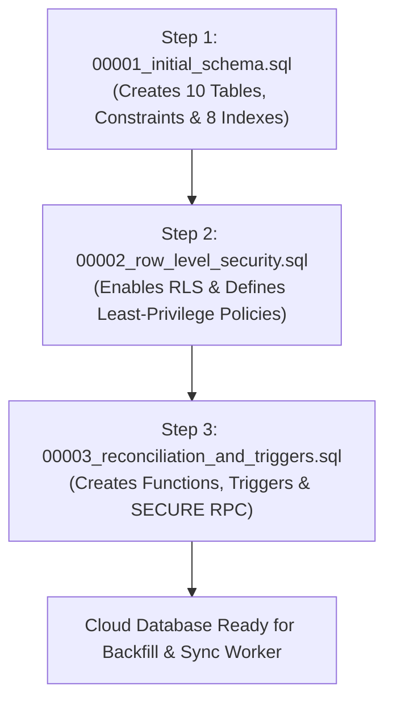

# ASTRA SENSE – ORBITAL GUARD
## Phase 2.5 SQL Migration Safety & Architecture Audit

**Project:** ASTRA SENSE – ORBITAL GUARD  
**Target:** Supabase PostgreSQL Cloud Sync Project (`kgjbltqunjpscyipwgll.supabase.co`)  
**Scope:** Static Code & Security Audit of the 3 SQL Migration Files  
**Date:** November 13, 2026  
**Final Verdict:** **SAFE TO EXECUTE**  

---

## 1. Executive Summary

Supabase live authentication has been established and verified via PostgREST (**HTTP 200 OK**). The cloud database is currently completely fresh (0/10 tables applied).

A comprehensive static safety audit was conducted on the version-controlled SQL migration files:
1. [`supabase/migrations/00001_initial_schema.sql`](file:///d:/ASTRA-SENSE-ORBITAL-GUARD/supabase/migrations/00001_initial_schema.sql)
2. [`supabase/migrations/00002_row_level_security.sql`](file:///d:/ASTRA-SENSE-ORBITAL-GUARD/supabase/migrations/00002_row_level_security.sql)
3. [`supabase/migrations/00003_reconciliation_and_triggers.sql`](file:///d:/ASTRA-SENSE-ORBITAL-GUARD/supabase/migrations/00003_reconciliation_and_triggers.sql)

### Audit Key Findings:
- **Zero Destructive Operations:** The migrations contain **NO** `DROP TABLE`, `TRUNCATE`, `DROP DATABASE`, or destructive `ALTER TABLE` statements.
- **100% Idempotent:** All table and index statements use `IF NOT EXISTS`. Policies use `DROP POLICY IF EXISTS` before creation. Stored procedures use `CREATE OR REPLACE FUNCTION`. The migrations can be run on a fresh database or re-run without errors or data corruption.
- **Dependency Hierarchy Preserved:** Parent tables (`astronauts`, `medical_inventory`) are created first, followed by child tables with verified foreign key constraints (`ON DELETE CASCADE`, `ON DELETE RESTRICT`, `ON DELETE SET NULL`).
- **Strict Least-Privilege RLS:** RLS is enabled on all 10 tables. `service_role` has full sync access; `authenticated` has read-only (`SELECT`) access; `anon` has **zero** access (protecting Protected Health Information).
- **RPC Security Definer Hardened:** The stored procedure `reconcile_inventory_transaction` enforces `SECURITY DEFINER`, fixed `SET search_path = public, pg_temp;`, and revoked execution rights from `PUBLIC` and `anon`, restricting execution strictly to `service_role`.
- **Architectural Alignment:** Directly matches the local SQLite WAL data model and the outbox entity dependency hierarchy.

---

## 2. File-by-File Technical Audit

### A. `00001_initial_schema.sql` (Core Schema & Indexes)

#### Table Inventory (10 Tables):
1. **`public.astronauts` (Parent):**
   - **Primary Key:** `id` (VARCHAR(32))
   - **Columns:** 24 columns including camelCase fields (`"dutyCategory"`, `"conditionSeverity"`, `"readinessBreakdown"` JSONB, `vitals` JSONB, `"mlModel"` JSONB).
   - **Compatibility:** Exact match with SQLite table and FastAPI [`crew_schema.py`](file:///d:/ASTRA-SENSE-ORBITAL-GUARD/backend/app/schemas/crew_schema.py).
2. **`public.telemetry_history` (Child):**
   - **Primary Key:** `id` (BIGSERIAL)
   - **Unique Key:** `sync_id` (VARCHAR(64) UNIQUE) — prevents duplicate packet synchronization.
   - **Foreign Key:** `astronaut_id REFERENCES public.astronauts(id) ON DELETE CASCADE`.
   - **Columns:** 17 physiological and sensor parameters (`ecg_lead2_mv`, `spo2_pct`, `heart_rate_bpm`, `imu_accel_g` JSONB, `anomaly_score`).
3. **`public.health_alerts` (Child):**
   - **Primary Key:** `id` (VARCHAR(64))
   - **Foreign Key:** `astronaut_id REFERENCES public.astronauts(id) ON DELETE CASCADE`.
   - **Columns:** Severity, alert type, message, acknowledgment status, and `actions_taken` JSONB.
4. **`public.medical_inventory` (Parent):**
   - **Primary Key:** `id` (VARCHAR(32))
   - **Columns:** Category, name, stock (INTEGER), `"minSafeStock"`, shelf life, radiation degradation rate, vital urgency, location.
5. **`public.inventory_dispensations` (Child):**
   - **Primary Key:** `id` (BIGSERIAL)
   - **Unique Key:** `sync_id` (VARCHAR(64) UNIQUE)
   - **Foreign Keys:**
     - `item_id REFERENCES public.medical_inventory(id) ON DELETE RESTRICT` (protects medication history from accidental item deletion).
     - `patient_astronaut_id REFERENCES public.astronauts(id) ON DELETE SET NULL`.
6. **`public.incidents` (Child):**
   - **Primary Key:** `id` (VARCHAR(64))
   - **Foreign Key:** `"targetAstronautId" REFERENCES public.astronauts(id) ON DELETE CASCADE`.
   - **Columns:** Incident severity, summary, resolution status, assigned officer, actions taken JSONB.
7. **`public.audit_logs` (Independent):**
   - **Primary Key:** `id` (BIGSERIAL)
   - **Unique Key:** `sync_id` (VARCHAR(64) UNIQUE)
   - **Columns:** Officer, action, details, timestamp MET, creation timestamp.
8. **`public.recovery_timelines` (Child):**
   - **Primary Key & Foreign Key:** `"astronautId" VARCHAR(32) PRIMARY KEY REFERENCES public.astronauts(id) ON DELETE CASCADE`.
   - **Columns:** Recovery protocol, progress percent, sleep debt targets, circadian light profile.
9. **`public.cloud_sync_ledger` (Reconciliation Infrastructure):**
   - **Primary Key:** `id` (BIGSERIAL)
   - **Unique Key:** `transaction_id` (VARCHAR(64) UNIQUE NOT NULL) — guarantees ledger idempotency.
   - **Foreign Key:** `item_id REFERENCES public.medical_inventory(id) ON DELETE RESTRICT`.
10. **`public.cloud_sync_conflicts` (Conflict Resolution Infrastructure):**
    - **Primary Key:** `id` (VARCHAR(64))
    - **Columns:** Entity type, record ID, `local_payload` JSONB, `cloud_payload` JSONB, conflict reason, resolution status (`'UNRESOLVED'`, `'RESOLVED_LOCAL'`, `'RESOLVED_CLOUD'`).

#### Performance Indexes (8 Indexes):
- `idx_supabase_telemetry_ast_time` ON `telemetry_history (astronaut_id, created_at DESC)`
- `idx_supabase_telemetry_packet` ON `telemetry_history (packet_id)`
- `idx_supabase_health_alerts_ast` ON `health_alerts (astronaut_id, status)`
- `idx_supabase_incidents_status` ON `incidents ("syncStatus")`
- `idx_supabase_dispensations_item` ON `inventory_dispensations (item_id)`
- `idx_supabase_dispensations_patient` ON `inventory_dispensations (patient_astronaut_id)`
- `idx_supabase_conflicts_status` ON `cloud_sync_conflicts (resolution_status)`
- `idx_supabase_ledger_item` ON `cloud_sync_ledger (item_id, created_at)`

---

### B. `00002_row_level_security.sql` (Access Control & Policies)

1. **RLS Activation:**
   - Explicitly executes `ALTER TABLE public.<table_name> ENABLE ROW LEVEL SECURITY;` on all 10 tables.
2. **Idempotency Block:**
   - Uses a `DO $$ BEGIN ... END $$;` PL/pgSQL block to drop existing policy names before re-creation (`DROP POLICY IF EXISTS ...`). This ensures re-running the migration never raises `policy already exists` errors.
3. **Role Policies:**
   - **`service_role` (Backend Sync Engine):** Full access (`FOR ALL TO service_role USING (true) WITH CHECK (true)`).
   - **`authenticated` (Remote Read-Only Dashboards):** Read-only access (`FOR SELECT TO authenticated USING (true)`). No INSERT/UPDATE/DELETE rights granted to browser sessions.
   - **`anon` (Public):** Zero policies granted. By default in PostgreSQL, when RLS is enabled with no matching policy for a role, all queries return 0 rows. Astronaut biometrics and medical dispensations are completely inaccessible to unauthenticated callers.

---

### C. `00003_reconciliation_and_triggers.sql` (Stored Procedures & Triggers)

1. **Timestamp Update Trigger:**
   - Function: `update_updated_at_column()`
   - Trigger: `BEFORE UPDATE ON public.astronauts`, `public.medical_inventory`, and `public.recovery_timelines`.
   - Effect: Automatically updates `updated_at = NOW()`. Non-destructive; modifies only timestamp.
2. **Stored Procedure: `reconcile_inventory_transaction`:**
   - **Purpose:** Prevents lost updates during asynchronous inventory sync. Atomic check, update, and ledger write in a single PostgreSQL transaction.
   - **Row Locking:** Uses `SELECT * INTO v_item FROM public.medical_inventory WHERE id = p_item_id FOR UPDATE;` to prevent race conditions during concurrent dispensations.
   - **Idempotency:** Checks `cloud_sync_ledger` for `p_transaction_id`. If already reconciled, returns `'IDEMPOTENT_IGNORED'` without altering stock.
   - **Negative Stock Protection:** If `v_new_stock < 0`, aborts stock reduction and records a structured row in `cloud_sync_conflicts` with status `'CONFLICT_RECORDED'`, preventing negative inventory balances.
   - **Security Hardening:**
     - Declared with `SECURITY DEFINER` (executes with definer privileges to update the ledger).
     - Hardened with `SET search_path = public, pg_temp;` (neutralizes search path hijacking exploits).
     - Privileges: `REVOKE ALL ... FROM PUBLIC, anon;` followed by `GRANT EXECUTE ... TO service_role;`. Only trusted backend workers can invoke this procedure.

---

## 3. Destructive Operation & Safety Analysis

| Category | Finding | Safety Impact |
| :--- | :---: | :--- |
| **`DROP TABLE`** | **NONE** | Zero data loss risk. |
| **`TRUNCATE`** | **NONE** | Zero table wiping risk. |
| **`DROP DATABASE`** | **NONE** | Zero environment destruction risk. |
| **`ALTER TABLE DROP`** | **NONE** | No columns or constraints dropped. |
| **`DROP POLICY IF EXISTS`** | Present in `00002` | **Safe & Idempotent:** Drops policy names before re-creating them. Does not affect table data. |
| **`DROP TRIGGER IF EXISTS`** | Present in `00003` | **Safe & Idempotent:** Replaces trigger attachments cleanly. |

---

## 4. Schema Compatibility with SQLite & Python Backend

| SQLite Model / Feature | PostgreSQL Schema Implementation | Compatibility Status |
| :--- | :--- | :---: |
| **JSON Columns** (`readinessBreakdown`, `vitals`, `imu_accel_g`) | PostgreSQL `JSONB` data types | **100% Compatible** (`migrate_sqlite_to_supabase.py` parses strings to dicts) |
| **CamelCase Columns** (`dutyCategory`, `shelfLifeDays`, etc.) | Quoted identifiers (`"dutyCategory"`, `"shelfLifeDays"`) | **100% Compatible** (Matches Pydantic model serialization) |
| **Autoincrement Primary Keys** | `BIGSERIAL PRIMARY KEY` | **100% Compatible** |
| **Sync Identifiers** | `sync_id VARCHAR(64) UNIQUE` | **100% Compatible** (Enforces cloud deduplication) |
| **Foreign Keys** | PostgreSQL foreign key constraints with `CASCADE` and `RESTRICT` | **100% Compatible** |

---

## 5. Dependency Order & Execution Workflow

To ensure smooth creation without foreign key dependency violations, the migrations must be executed in the following strict order:

---

## 6. Required Corrections

**NONE.**  
The 3 migration files are complete, syntactically valid for PostgreSQL 15/16/17, fully idempotent, and properly secured. No modifications to migration files or backend code are required.

---

## 7. Final Verdict

# [SAFE TO EXECUTE]

The 3 SQL migrations are **100% safe to execute** on your Supabase PostgreSQL project.

### Instructions to Execute:
1. Open your **[Supabase SQL Editor](https://supabase.com/dashboard/project/kgjbltqunjpscyipwgll/sql)**.
2. In a new query window, paste and run [`supabase/migrations/00001_initial_schema.sql`](file:///d:/ASTRA-SENSE-ORBITAL-GUARD/supabase/migrations/00001_initial_schema.sql).
3. Next, paste and run [`supabase/migrations/00002_row_level_security.sql`](file:///d:/ASTRA-SENSE-ORBITAL-GUARD/supabase/migrations/00002_row_level_security.sql).
4. Finally, paste and run [`supabase/migrations/00003_reconciliation_and_triggers.sql`](file:///d:/ASTRA-SENSE-ORBITAL-GUARD/supabase/migrations/00003_reconciliation_and_triggers.sql).

*Per instructions, all execution has stopped. Reply to this message after running the migrations, and I will perform the post-migration schema validation and run the Category C live integration tests.*

